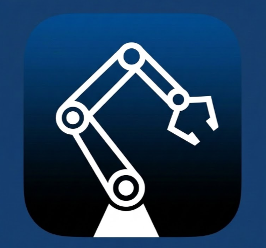

# Tide Workstation



这是我开发的机械臂数据采集软件，免费分享给想要学习具身智能的爱好者朋友们。

从连接机械臂、采集演示数据，到回放检查、训练和运行模型，在一个桌面工作站里完成。

**[下载 Windows 应用](https://github.com/Allentide/Tide-workstation/releases/tag/v1.0.0-windows-preview.84) · [Windows 安装说明](docs/INSTALL-Windows.md) · [下载 macOS 应用](https://github.com/Allentide/Tide-workstation/releases) · [安装说明](docs/INSTALL-macOS.md) · [使用说明](docs/USAGE.md) · [反馈问题](https://github.com/Allentide/Tide-workstation/issues)**

## 主要功能

- 设备配置：发现主从臂串口、添加相机、保存设备组。
- 校准与遥操作：调用 LeRobot 0.6.0 官方 SO-101 校准和控制流程。
- 数据采集：创建采集任务、实时预览、按 Episode 录制演示。
- 数据集管理：导入、回放、检查与标注数据。
- 模型训练：配置 ACT / SmolVLA 训练任务，查看进度与日志。
- 模型运行：管理本地模型，在已配置的设备组上进行推理验证。

## 什么是模仿学习？

简单来说，就是**你先示范，机器人再学习怎么做**。例如“把方块放进盒子”：你通过主臂遥操作从臂完成多次示范，系统记录相机画面、机械臂状态和控制动作，再用这些数据训练一个根据当前观察预测动作的模型。

```text
人工遥操作示范 → 采集 Episode → 检查与筛选数据 → 训练模型 → 实机推理验证
```

Tide Workstation 将这条流程放进同一个桌面软件中，底层调用 LeRobot：

- **采集**：一次任务尝试通常记录为一个 Episode，包含视频及对应的状态、动作数据。只有视频通常不足以直接训练本软件使用的机器人动作策略。
- **训练**：模型学习“看到这样的画面和状态时，应该执行什么动作”。当前支持 ACT 和 SmolVLA。
- **推理**：模型读取实时画面和机械臂状态，生成控制动作，而不是简单重放某段录制轨迹。

**ACT 与 SmolVLA 有什么区别？** ACT 根据图像和机器人状态预测一段动作序列，标准 ACT 不以自然语言任务描述作为输入；SmolVLA 是视觉-语言-动作模型，可结合画面、机器人状态和任务文本，通过示范数据微调适配任务。详见 [LeRobot ACT 介绍](https://huggingface.co/docs/lerobot/act)和 [SmolVLA 介绍](https://huggingface.co/docs/lerobot/smolvla)。

**需要知道的边界**：这不是安装软件后就能完成任意任务的通用机器人。效果取决于示范质量、场景覆盖及训练设置；物体、位置、光照或相机视角变化后仍需重新验证。成功/失败标签用于筛选和管理数据，不会自动让标准 ACT 理解“成功”或“失败”。训练 Loss 降低也不等于实机成功率提高，仍需在安全条件下测试。推理记录不会自动更新模型，需要筛选后再次训练。

## 让 AI 帮你下载安装

把下面这段提示词直接复制给 AI，即可让它按你的电脑情况协助下载软件、配置环境并检查是否可用：

```text
请阅读 https://github.com/Allentide/Tide-workstation 的 README 及相关安装说明，按我的电脑系统帮我下载软件、配置运行环境并验证是否可用，优先复用已有环境。
```

## Windows 快速开始

1. 下载 Windows x64 预览包，完整解压，运行 `data_collector_workstation.exe`。
2. 按 [Windows 安装说明](docs/INSTALL-Windows.md)准备 Python 3.12、LeRobot 0.6.0 与 PyTorch 环境。
3. 进入本地模式，完成设备配置、校准和遥操作后开始采集。

## 用 AI 处理 Windows 运行环境

已有 Python、Conda 或 LeRobot 环境，以及全新电脑，都可以使用下面的提示词。让 AI 先检查再决定复用或安装，并验证 Tide Workstation 能实际使用选定的环境。

将整段提示词复制给 AI。具备本机终端权限的 AI 可以在你授权后执行。普通聊天 AI 会分步骤给出 PowerShell 命令，你执行后把结果发回。软件解压目录可以自由选择，环境路径的识别和接入由 AI 按说明协助处理。

```text
请帮我把这台 Windows 10/11 x64 电脑上的 Tide Workstation 运行环境处理好。我希望使用软件连接 SO-101 主从臂和相机、采集数据、训练 ACT 并运行推理。我可能已有 Python、Conda、venv、LeRobot 或 PyTorch，也可能尚未安装，请先检查实际情况。

请先读取软件安装说明：
https://github.com/Allentide/Tide-workstation/blob/main/docs/INSTALL-Windows.md
以该版本说明和实际检查结果为准。无法访问时，请让我粘贴内容。

一、检查已有环境
查找 Python 3.12、Conda/venv 环境和已安装的 LeRobot、PyTorch，同时检查 GPU、可用磁盘空间及软件解压目录。先检查常见目录、py -0p、where.exe python、可用时的 conda env list 和我提供的路径，避免扫描整个磁盘。
逐个使用候选环境的 python.exe 实际读取版本、导入依赖，检查 PyTorch 加速能力。简短列出候选环境的路径、版本、缺失依赖和推荐选择。

二、根据实际情况准备依赖
已有兼容环境时优先复用。当前版本要求 Python 3.12、LeRobot 0.6.0，PyTorch、OpenCV、相机枚举、串口、视频读写和其他依赖按安装说明准备。
需要修改已有环境的版本时，先说明对其他项目的影响，让我选择补齐原环境或创建独立环境。缺少环境时按说明创建。下载前告知内容、目标目录和预计磁盘占用，不确定的大小要明确标注。
安装依赖始终使用选定环境的完整 python.exe 路径加 -m pip，避免装进其他 Python。根据硬件和驱动选择 PyTorch，实际验证 torch.cuda.is_available()。GPU 条件不足时说明性能影响，让我决定下一步。驱动安装或升级需单独获得我的确认。

三、让软件识别这个环境
当前软件按路径优先级查找 Python。激活 Conda/venv 或在终端成功 import，只能作为环境本身的验证，接下来还要核对软件实际选中的解释器。
软件可识别的统一环境入口为：
%LOCALAPPDATA%\EmbodyData\unified-runtime\lerobot-0.6.0
PowerShell 中通过 $env:LOCALAPPDATA 解析当前用户目录。新环境可以直接创建在该位置。
已有 venv 在其他位置时，可以把该入口创建为指向已有环境根目录的 Windows Junction，从而共用依赖文件。目标根目录须包含 Scripts\python.exe。Windows Conda 通常只有根目录的 python.exe，直接链接这种布局无法满足当前软件查找规则，遇到这种情况请按说明创建独立 venv。创建前先验证目标解释器、依赖和磁盘，并说明链接用途。
入口已经存在时，先检查它是实际环境还是目录链接，以及其中的依赖是否可用。复用有效环境。若需要替换入口，先说明现状并等我选择处理方式。保留现有目录、原环境和数据。
也请检查影响启动选择的 TIDE_COLLECTOR_AGENT_EXECUTABLE、SO101_RUNTIME_EXECUTABLE 等已有设置。只报告相关路径，不读取或展示无关凭据。修改前解释其作用。软件会把这些变量当作 collector-agent 可执行入口，因此直接填 python.exe 会缺少启动脚本参数。

四、核对应用组件和模型权重
collector-agent 是 Tide Workstation 随软件交付的自有组件。核对应用包中的 sidecar Python 模块、资源清单和启动脚本，应用将使用选定的 Python 运行它。自有组件缺失时，指导我重新完整解压对应版本的发布包。
默认先完成 ACT 环境。根据当前 ACT 配置查明所需视觉骨干权重，在获得下载授权后放入软件运行环境实际使用的缓存中，并验证可加载。等我明确选择 SmolVLA 时，再准备相应依赖和预训练权重。

五、验证并交接
先验证实际解释器路径、Python/LeRobot/PyTorch/OpenCV 等版本、相机和串口模块导入、视频读写依赖、CUDA 状态以及 ACT 权重加载情况。
再让我重启 Tide Workstation，通过软件环境检查结果、日志或其 Sidecar 进程命令行，确认应用真正使用了选定环境。检查过程中保留我的设备配置、校准文件、采集数据和模型。执行连接机械臂、启动力矩、真实采集或推理前，等我确认设备已准备好。
请执行安装说明中的 tools/check_environment.py，使用应用释放的实际 Sidecar 路径。该脚本读取当前产品的缓存计算逻辑，检查默认视频编码解码和 ACT 权重。得到我的下载授权后使用 --download-act，选择 SmolVLA 后再使用 --download-smolvla。目录链接后的缓存以脚本结果和应用进程环境为准。
确认旧 Sidecar 路径、前缀参数和工作目录没有改变软件实际入口。随后按安装说明的全流程验收完成短采集、回放、ACT 冒烟训练、检查点确认及经我授权的推理和停止。记录每一步结果。仅完成环境脚本时报告“环境检查通过，真实采集/训练/推理待验收”。
最后用简短清单说明复用了哪个环境、安装了什么、建立了哪些路径链接、哪些检查通过，以及哪些实际采集/训练/推理步骤仍需验证。

如果你有本机终端能力，请在我的授权范围内执行并持续处理错误。如果你只能提供文字，每次给我一个步骤的 PowerShell 命令，等待执行结果后继续。遇到错误先诊断，再决定修复方式。
```

环境确认后，可在软件中依次完成“设备配置 → 采集 → 数据集管理 → 本地训练 → 模型库”。Windows 手动安装命令见 [安装说明](docs/INSTALL-Windows.md)。

## macOS 如何开始

1. 在 Releases 下载 `Tide-workstation-macOS-preview.83.zip`，解压后将 `.app` 拖到“应用程序”。
2. 按[安装说明](docs/INSTALL-macOS.md)安装 Python 3.12 与 LeRobot 0.6.0 环境，不需要 Conda、Flutter 或 Xcode 编译工程。
3. 打开软件，进入本地模式，依次完成设备配置、校准、遥操作验证和数据采集。

macOS 预览版面向 Apple Silicon Mac。应用二进制架构以 Release 说明为准；本文的训练运行时安装命令仅面向 Apple Silicon，未完成 Intel Mac 的端到端验证。

本地采集不需要云端账号。云端功能需要另行配置兼容服务端，本仓库不提供公共云服务。

## 用 AI 帮你准备 macOS 环境

适用于 Apple Silicon（M 系列芯片）Mac。将下面整段复制给 AI：有本机终端权限时可授权执行；普通聊天 AI 会逐步给出命令，由你在“终端”执行并反馈结果。

```text
请帮我在这台 Apple Silicon Mac 上准备 Tide Workstation 的标准运行环境，用于 SO-Arm101（SO-101）主从臂遥操作数据采集、回放和标注，以及 ACT 模型训练和推理。

先阅读本软件的 macOS 安装说明，以其中指定的依赖版本和目录为准：
https://github.com/Allentide/Tide-workstation/blob/main/docs/INSTALL-macOS.md
如果无法访问，请让我粘贴文档内容后继续，不要凭记忆换用其他版本。

请按以下顺序处理：
1. 检查 macOS 版本、芯片、当前进程架构、Homebrew、Python 3.12 和可用磁盘空间。确认使用 arm64 原生环境；若是 Intel Mac 或 Rosetta 下的 x86_64 环境，先说明本安装方案不适用，不混装两种架构。
2. 优先检查现有 arm64 Python 3.12 venv/Conda 环境，保留其他项目。缺少兼容环境时，按需准备 Homebrew、其要求的 Command Line Tools 和 Homebrew Python 3.12。安装前列出下载内容、预计空间和目标目录，获得授权后执行。
3. 软件的环境入口为 "$HOME/Library/Application Support/EmbodyData/unified-runtime/lerobot-0.6.0/bin/python"。兼容的已有环境可用符号链接接入其根目录，先确认目标 bin/python 和架构。入口已存在时先检查再处理。所有带空格的路径都加引号，用当前用户的 $HOME。完整退出并重开 Finder 中的应用后，核对其实际解释器。
4. 始终使用目标环境的 bin/python -m pip 安装。按说明准备 Python 3.12、LeRobot 0.6.0、torch 2.11.0、torchvision 0.26.0，以及 OpenCV、相机枚举、Feetech、pyserial、PyAV、accelerate 等依赖。使用 macOS 原生 PyTorch，不使用 CUDA wheel，不擅自升级锁定版本。运行 pip check，发现冲突先解释具体原因。
5. collector-agent / Sidecar 已随 .app 交付，不另找同名第三方包安装，也不要求下载工程源码。软件首次启动会释放自有 Sidecar；使用标准目录里的 Python 运行它。不要把 Python 路径填进用于 collector-agent 可执行入口的环境变量，不依赖终端激活状态来让 Finder 启动的软件找到环境。
6. 先验证基础环境：报告 sys.executable、Python 架构和版本、LeRobot/PyTorch/torchvision 版本；验证 cv2、cv2_enumerate_cameras、serial、av、h5py、accelerate 及 SO101Follower 能否导入。检查 torch.backends.mps.is_available()，并尝试在 MPS 上创建一个小张量和完成运算。若为 False 或运算失败，报告实际错误，不能宣称 Apple GPU 已可用。模块能导入不等于真实硬件已通过测试。
7. 默认准备 ACT。执行安装说明中的 tools/check_environment.py，传入应用释放的实际 Sidecar 目录。脚本按当前产品的缓存函数计算 TORCH_HOME/HF_HOME，验证采集/训练/推理入口、默认视频编码解码、加速设备张量运算及 ACT 权重校验和加载。获授权后用 --download-act 下载缺失的 ResNet18 权重，处理每个 FAIL。
8. 选择 SmolVLA 后，按说明安装额外依赖，再经授权执行 --download-smolvla，下载产品锁定 revision 的两组权重。随后用 --smolvla 做本地缓存检查。符号链接会影响解析后的缓存位置，Finder 应用可能与终端具有不同的 HF_HOME/TORCH_HOME，必须核对实际进程环境。
9. 如果我已有训练好的 ACT/SmolVLA 模型，指导我在“模型库 → 导入本地模型”选择完整 pretrained_model 目录。它应包含 config.json、model.safetensors、policy_preprocessor.json、policy_postprocessor.json 及处理器引用的其他文件。基础预训练权重不等于已经学会具体任务的模型；推理前需要核对主从臂配置、相机名称和模型输入。
10. 完成后让我重新打开 .app，核对实际 Sidecar 解释器及缓存，检查旧入口、参数和工作目录。经我确认硬件操作后按安装说明完成短采集、回放、ACT 冒烟训练、最终检查点和短推理/手动停止验收，记录训练与推理日志中的最终 device。由我处理 macOS 相机权限。每个步骤通过后再记录结果。

发生错误时根据具体输出排查，不删除设备配置、校准、数据集或模型，不关闭 macOS 安全保护。出现 OpenCV/PyAV 的 AVFoundation 重复类警告时单独记录，不直接删除动态库，也不把警告当成验证通过。

如果你能执行本机命令，在授权范围内直接处理；否则每次只给我一步可复制的 zsh 命令，等我反馈结果再继续。最后分别列出“环境已验证”“权重已验证”“仍需软件/真实硬件验证”，不要把安装完成说成全流程已验收。
```

采集、回放和标注不需要预训练模型权重。训练和推理需要各自对应的依赖、权重或完整任务模型；可先准备基础采集环境，再按需准备模型。

## 发布内容

此仓库当前用于分发**编译好的应用和文档**，暂不公开完整工程源码，也不声明为开源授权项目。

应用包含运行必需的 Sidecar 组件；下载包不包含 Python 虚拟环境、第三方训练环境、预训练权重、个人设备配置、采集数据、构建缓存或开发仓库历史。第三方组件仍遵循各自许可。软件免费提供给具身智能爱好者学习使用。

本次发布为预览版，已在开发机完成构建和包结构检查；全新 Windows / Mac 的端到端安装与真实硬件验收仍待完成。请参阅各平台的安装说明。

## 反馈

请在 Issues 描述复现步骤，附上操作系统版本、处理器或显卡型号、应用版本和错误日志片段。分享日志前请移除账号凭据和个人信息。
